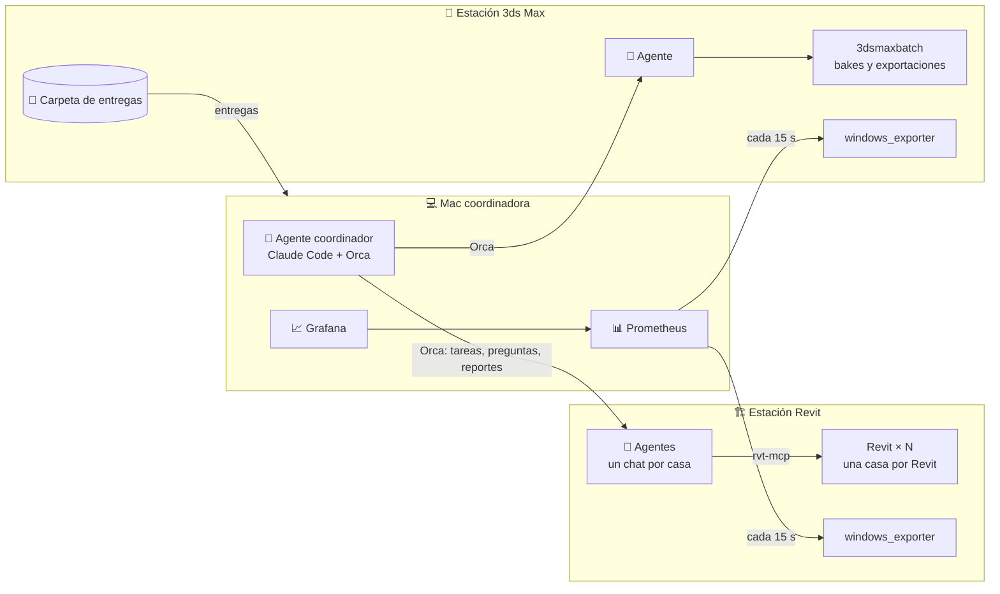

# 🛰️ Agentic Orchestration & Virtualization

**Orquestación de agentes de IA entre las estaciones de trabajo de arquitectura de UONDR**

---

## 🎯 ¿De qué trata?

En UONDR trabajamos con agentes de IA que operan **Revit** y **3ds Max** en las estaciones de trabajo del equipo de arquitectura. Este proyecto busca que:

- ⚡ **Arquitectos y agentes trabajen en paralelo**, cada casa en su propio Revit.
- 🔁 **Los agentes se comuniquen entre máquinas** sin pasar por WhatsApp.
- 📦 **Las entregas lleguen y se validen solas.**
- 🔥 **Los bakes pesados se repartan** para acortar ciclos de horas.
- 📈 **Se vea el consumo de recursos** de cada estación con historial.

## 🧩 Cómo está armado

Todo viaja por **Tailscale**, la red privada que une las tres máquinas.

| Capa | Herramienta | Qué hace |
|---|---|---|
| 🛣️ Red | Tailscale | Nombres y direcciones fijas, cifrado, funciona dentro y fuera de la oficina |
| 📨 Orquestación | Orca | La Mac lanza agentes en las estaciones, les manda tareas y recibe sus reportes |
| 🤖 Ejecución | Claude Code + rvt-mcp / scripts de 3ds Max | Los agentes trabajan en Revit y 3ds Max |
| 📦 Archivos | Carpeta compartida de Windows | Las entregas grandes llegan a la Mac |
| 📈 Observabilidad | Prometheus + Grafana + windows_exporter | Historial de procesador, RAM, disco, tarjeta de video y consumo por programa |
| 🔔 Avisos | Discord | Alertas de Grafana y avisos del agente coordinador en un canal |

## 🗺️ Estado

| Prueba | Pregunta | Estado |
|---|---|---|
| P1 🌐 Red | ¿Las tres máquinas se ven y llega un ZIP de 1.3 GB? | ✅ 1.3 GB en 39 s |
| P2 🔗 Orca entre máquinas | ¿La Mac entra al Orca de cada estación? | ✅ |
| P3 💬 Ida y vuelta | ¿Los agentes se preguntan y responden solos? | ✅ |
| P4 🏠 Dos Revit | ¿Dos agentes en dos casas a la vez sin estorbar? | ✅ 0 errores |
| P5 🔥 Bake trabajando | ¿La arquitecta sigue en Max durante un bake? | ⬜ |
| P6 🖥️ Bake en otra PC | ¿La cadena corre en otra estación y qué licencias pide? | ⬜ |
| P7 📦 Entrega sin WhatsApp | ¿La entrega llega y se valida sola? | ✅ v12: 1.38 GB en 55 s, huella y validador correctos |
| 📈 Observabilidad | ¿Vemos el historial de recursos de cada estación? | ✅ Tablero UONDR con ficha técnica. Alertas y avisos por Discord |

Detalle en [tracking/hitos.md](tracking/hitos.md) y [tracking/ejecuciones.md](tracking/ejecuciones.md).

## 📂 Contenido del repo

| Carpeta | Qué hay |
|---|---|
| [`docs/`](docs) | Plan general, pruebas, observabilidad y reglas para los agentes |
| [`docs/agentes/`](docs/agentes) | Instrucciones para los agentes: reglas de la estación Revit y canales del recorrido 3D |
| [`observabilidad/`](observabilidad) | Scripts y configuración de Prometheus, Grafana y windows_exporter |
| [`tracking/`](tracking) | Hitos y bitácora de ejecuciones |

> [!NOTE]
> Este repo es público. Nombres de personas, direcciones, usuarios de Windows, enlaces de emparejamiento y nombres de proyectos de clientes **no se publican**: viven en archivos locales ignorados por git (`.env`, `privado/`).
