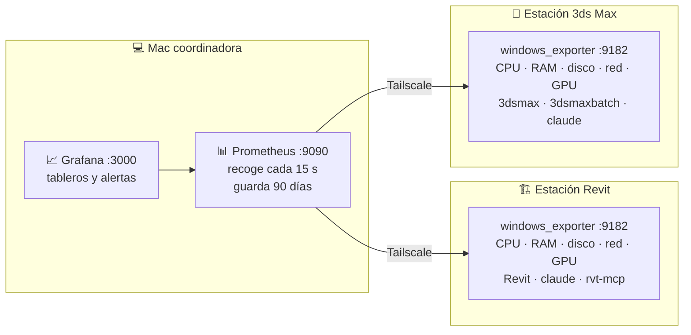

# 📈 Observabilidad

Historial de procesador, RAM, disco, red, tarjeta de video y consumo **por programa** de cada estación, para medir pruebas, decidir compras y entender qué pasó cuando algo falla.

## Componentes



| Pieza | Dónde | Qué hace | Puerto |
|---|---|---|---|
| windows_exporter 0.32.1 | Cada estación, como servicio | Publica las métricas del sistema, de la tarjeta de video y de los programas elegidos | 9182 |
| Prometheus | Mac coordinadora | Pasa cada 15 s a recoger las métricas y guarda 90 días | 9090, solo local |
| Grafana | Mac coordinadora | Tableros, alertas y marcas de eventos | 3000, solo local |

La Mac se duerme fuera del horario de trabajo. Como el equipo trabaja en el mismo horario, los huecos de noche no importan.

## Qué se mide por programa

Solo los procesos que importan, para no llenar el historial de datos inútiles:

`Revit`, `3dsmax`, `3dsmaxbatch`, `claude`, `rvt-mcp`

Para cada uno: uso de procesador, memoria, lectura y escritura de disco, y memoria de video.

## Instalación

### 1. Estaciones Windows

En PowerShell **como administrador**:

```powershell
.\observabilidad\windows\instalar-exporter.ps1
```

- Descarga el MSI oficial y verifica su SHA-256.
- Lo instala como servicio con los colectores necesarios y el filtro de procesos.
- Abre el puerto 9182 **solo para direcciones de Tailscale** (`100.64.0.0/10`).
- No requiere cerrar Revit ni 3ds Max.

### 2. Mac coordinadora

```bash
cd observabilidad/mac
cp .env.example .env      # escribir los nombres reales de las estaciones en Tailscale
./instalar.sh
```

- Instala Prometheus y Grafana con Homebrew como servicios.
- Genera la configuración de Prometheus a partir de `.env`, con 90 días de historial.
- Conecta Grafana con Prometheus.
- Prometheus y Grafana escuchan solo en la Mac (`127.0.0.1`).

Grafana queda en <http://127.0.0.1:3000>. El primer inicio pide cambiar la contraseña `admin`.

## Seguridad

- Nada se expone a internet. Las métricas viajan solo por Tailscale.
- El puerto 9182 de cada estación acepta solo direcciones de Tailscale.
- Los nombres reales de las máquinas viven en `observabilidad/mac/.env`, que no se publica.

## Estado

| Pieza | Versión | Estado |
|---|---|---|
| Prometheus | 3.16.0 | ✅ En la Mac desde 2026-11-13 |
| Grafana | 13.3.1 | ✅ En la Mac desde 2026-11-13 |
| windows_exporter, estación Revit | 0.32.1 | ✅ |
| windows_exporter, estación 3ds Max | 0.32.1 | ✅ |

Cada estación reporta dos tarjetas de video: la integrada del procesador y la NVIDIA. Para el tablero se filtra la NVIDIA.

## Operación diaria en la Mac

| Qué | Comando |
|---|---|
| Ver si los servicios corren | `brew services list` |
| Reiniciar | `brew services restart prometheus` · `brew services restart grafana` |
| Estado de las estaciones | <http://127.0.0.1:9090/targets> |
| Tableros | <http://127.0.0.1:3000> |
| Configuración | `/opt/homebrew/etc/prometheus.yml` · `/opt/homebrew/etc/grafana/grafana.ini` |
| Historial | `/opt/homebrew/var/prometheus` |

## Operación en las estaciones

| Qué | Comando en PowerShell |
|---|---|
| Ver si el medidor corre | `Get-Service windows_exporter` |
| Reiniciarlo | `Restart-Service windows_exporter`, como administrador |
| Ver sus datos | <http://127.0.0.1:9182/metrics> |
| Desinstalar | Panel de control → Programas → windows_exporter |

## Tablero UONDR · Estaciones

En Grafana: carpeta **UONDR** → **UONDR · Estaciones**, o directo en <http://127.0.0.1:3000/d/uondr-estaciones>.

| Sección | Qué muestra |
|---|---|
| 🚦 Ahora | Conexión, procesador, RAM, Revit abiertos, bakes en curso y temperatura de la NVIDIA, por estación |
| 📈 Tendencia | Procesador y RAM de las dos estaciones en el tiempo |
| 🧩 Por programa | RAM, procesador y memoria de video de Revit, 3dsmax, 3dsmaxbatch, claude y rvt-mcp. Una fila por estación |
| 🏗️ Revit por instancia | RAM y procesador de cada Revit abierto, identificado por su `pid` |
| 🎮 Tarjeta de video NVIDIA | Uso, memoria de video y temperatura |
| 💾 Disco y red | Espacio libre por disco y tráfico de red |

Colores: azul para la estación Revit y para Revit, naranja para la estación 3ds Max y para 3dsmax. Verde, amarillo y rojo solo marcan umbrales: procesador y RAM al 75 % y 90 %, temperatura a 75 °C y 85 °C, disco con menos de 20 % y 10 % libre.

El tablero es código: se genera con `observabilidad/mac/grafana/generar_tablero.py`. Para cambiarlo se edita ese archivo y se corre:

```bash
python3 observabilidad/mac/grafana/generar_tablero.py --probar   # genera y prueba cada consulta
cp observabilidad/mac/grafana/dashboards/uondr.json /opt/homebrew/etc/grafana/dashboards/
```

Grafana lo recarga solo en 30 segundos. Los cambios hechos a mano en Grafana se pierden al regenerarlo.

## Siguientes pasos

| Paso | Qué |
|---|---|
| Alertas | RAM arriba del 90 %, disco casi lleno, estación desconectada, temperatura alta |
| Eventos de agentes | Los agentes marcan en Grafana el inicio y fin de cada bake o entrega |
