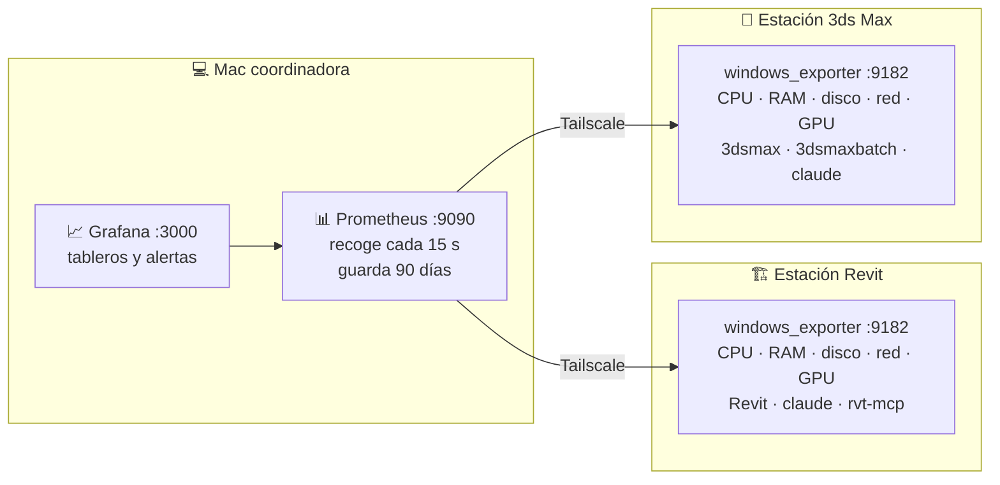

# 📈 Observabilidad

Historial de procesador, RAM, disco, red, tarjeta de video y consumo **por programa** de cada estación, para medir pruebas, decidir compras y entender qué pasó cuando algo falla.

## Componentes



| Pieza | Dónde | Qué hace | Puerto |
|---|---|---|---|
| windows_exporter 0.32.1 | Cada estación, como servicio | Publica las métricas del sistema, de la tarjeta de video y de los programas elegidos | 9182 |
| Prometheus | Mac coordinadora | Pasa cada 15 s a recoger las métricas y guarda 90 días | 9090, solo local |
| Grafana | Mac coordinadora | Tableros, alertas y marcas de eventos | 3000, solo local |

La Mac se duerme fuera del horario de trabajo. Como el equipo trabaja en el mismo horario, los huecos de noche no importan.

## Qué se mide por programa

Solo los procesos que importan, para no llenar el historial de datos inútiles:

`Revit`, `3dsmax`, `3dsmaxbatch`, `claude`, `rvt-mcp`

Para cada uno: uso de procesador, memoria, lectura y escritura de disco, y memoria de video.

## Instalación

### 1. Estaciones Windows

En PowerShell **como administrador**:

```powershell
.\observabilidad\windows\instalar-exporter.ps1
```

- Descarga el MSI oficial y verifica su SHA-256.
- Lo instala como servicio con los colectores necesarios y el filtro de procesos.
- Abre el puerto 9182 **solo para direcciones de Tailscale** (`100.64.0.0/10`).
- No requiere cerrar Revit ni 3ds Max.

### 2. Mac coordinadora

```bash
cd observabilidad/mac
cp .env.example .env      # escribir los nombres reales de las estaciones en Tailscale
./instalar.sh
```

- Instala Prometheus y Grafana con Homebrew como servicios.
- Genera la configuración de Prometheus a partir de `.env`, con 90 días de historial.
- Conecta Grafana con Prometheus.
- Prometheus y Grafana escuchan solo en la Mac (`127.0.0.1`).

Grafana queda en <http://127.0.0.1:3000>. El primer inicio pide cambiar la contraseña `admin`.

## Seguridad

- Nada se expone a internet. Las métricas viajan solo por Tailscale.
- El puerto 9182 de cada estación acepta solo direcciones de Tailscale.
- Los nombres reales de las máquinas viven en `observabilidad/mac/.env`, que no se publica.

## Siguientes pasos

| Paso | Qué |
|---|---|
| Tablero UONDR | Las dos estaciones lado a lado: RAM por Revit, bakes en curso, temperatura de la tarjeta |
| Alertas | RAM arriba del 90 %, disco casi lleno, estación desconectada, temperatura alta |
| Eventos de agentes | Los agentes marcan en Grafana el inicio y fin de cada bake o entrega |
