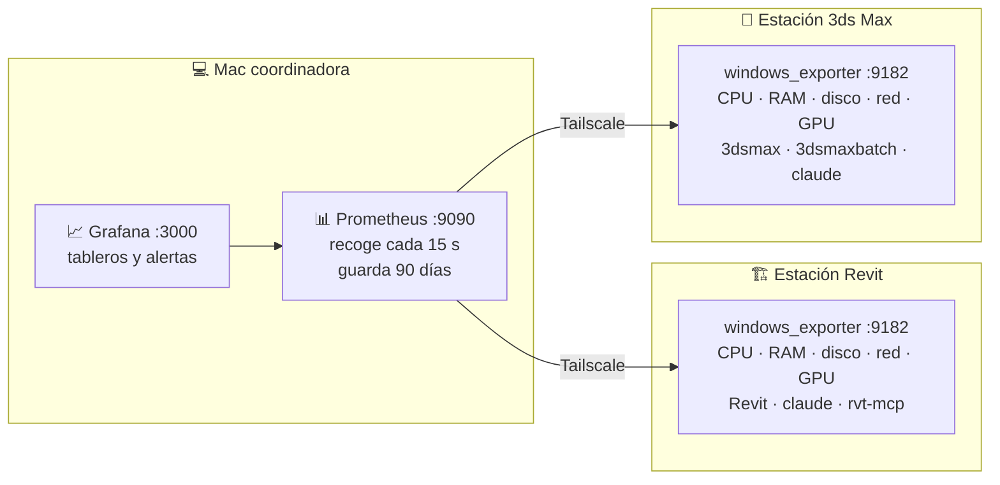

# 📈 Observabilidad

Historial de procesador, RAM, disco, red, tarjeta de video y consumo **por programa** de cada estación, para medir pruebas, decidir compras y entender qué pasó cuando algo falla.

## Componentes



| Pieza | Dónde | Qué hace | Puerto |
|---|---|---|---|
| windows_exporter 0.32.1 | Cada estación, como servicio | Publica las métricas del sistema, de la tarjeta de video y de los programas elegidos | 9182 |
| Prometheus | Mac coordinadora | Pasa cada 15 s a recoger las métricas y guarda 90 días | 9090, solo local |
| Grafana | Mac coordinadora | Tableros, alertas y marcas de eventos | 3000, solo local |

La Mac se duerme fuera del horario de trabajo. Como el equipo trabaja en el mismo horario, los huecos de noche no importan.

## Qué se mide por programa

Solo los procesos que importan, para no llenar el historial de datos inútiles:

`Revit`, `3dsmax`, `3dsmaxbatch`, `claude`, `rvt-mcp`

Para cada uno: uso de procesador, memoria, lectura y escritura de disco, y memoria de video.

## Instalación

### 1. Estaciones Windows

En PowerShell **como administrador**:

```powershell
.\observabilidad\windows\instalar-exporter.ps1
```

- Descarga el MSI oficial y verifica su SHA-256.
- Lo instala como servicio con los colectores necesarios y el filtro de procesos.
- Abre el puerto 9182 **solo para direcciones de Tailscale** (`100.64.0.0/10`).
- No requiere cerrar Revit ni 3ds Max.

### 2. Mac coordinadora

```bash
cd observabilidad/mac
cp .env.example .env      # escribir los nombres reales de las estaciones en Tailscale
./instalar.sh
```

- Instala Prometheus y Grafana con Homebrew como servicios.
- Genera la configuración de Prometheus a partir de `.env`, con 90 días de historial.
- Conecta Grafana con Prometheus.
- Prometheus y Grafana escuchan solo en la Mac (`127.0.0.1`).

Grafana queda en <http://127.0.0.1:3000>. El primer inicio pide cambiar la contraseña `admin`.

## Seguridad

- Nada se expone a internet. Las métricas viajan solo por Tailscale.
- El puerto 9182 de cada estación acepta solo direcciones de Tailscale.
- Los nombres reales de las máquinas viven en `observabilidad/mac/.env`, que no se publica.

## Estado

| Pieza | Versión | Estado |
|---|---|---|
| Prometheus | 3.16.0 | ✅ En la Mac desde 2026-11-13 |
| Grafana | 13.3.1 | ✅ En la Mac desde 2026-11-13 |
| windows_exporter, estación Revit | 0.32.1 | ✅ |
| windows_exporter, estación 3ds Max | 0.32.1 | ✅ |
| OhmGraphite + PawnIO, estación 3ds Max | 0.38.0 + 2.2.0 | ✅ Temperatura del procesador |
| OhmGraphite + PawnIO, estación Revit | 0.38.0 + 2.2.0 | ✅ Temperatura del procesador |

### Temperatura del procesador

Windows no expone la temperatura de los Ryzen. La lee **OhmGraphite**, un servicio basado en LibreHardwareMonitor que publica los sensores en el puerto 4445, con ayuda de **PawnIO**, un controlador firmado que reemplaza al antiguo WinRing0. Se instala con:

```powershell
.\observabilidad\windows\instalar-temperatura.ps1    # como administrador
```

El sensor del tablero es `Core (Tctl/Tdie)`. Prometheus lo recoge en el trabajo `sensores`.

### Vista sin contraseña, solo en la Mac

Con `OBS_VISTA_ANONIMA="si"` en `observabilidad/mac/.env`, Grafana permite ver los tableros en modo lectura sin iniciar sesión. Como Grafana escucha solo en `127.0.0.1`, esto aplica únicamente dentro de la Mac. Sirve para que el agente coordinador tome capturas del tablero. Para quitarlo: `OBS_VISTA_ANONIMA="no"` y volver a correr `instalar.sh`.

Cada estación reporta dos tarjetas de video: la integrada del procesador y la NVIDIA. Para el tablero se filtra la NVIDIA.

## Operación diaria en la Mac

| Qué | Comando |
|---|---|
| Ver si los servicios corren | `brew services list` |
| Reiniciar | `brew services restart prometheus` · `brew services restart grafana` |
| Estado de las estaciones | <http://127.0.0.1:9090/targets> |
| Tableros | <http://127.0.0.1:3000> |
| Configuración | `/opt/homebrew/etc/prometheus.yml` · `/opt/homebrew/etc/grafana/grafana.ini` |
| Historial | `/opt/homebrew/var/prometheus` |

## Operación en las estaciones

| Qué | Comando en PowerShell |
|---|---|
| Ver si el medidor corre | `Get-Service windows_exporter` |
| Reiniciarlo | `Restart-Service windows_exporter`, como administrador |
| Ver sus datos | <http://127.0.0.1:9182/metrics> |
| Desinstalar | Panel de control → Programas → windows_exporter |

## Tablero UONDR · Estaciones

En Grafana: carpeta **UONDR** → **UONDR · Estaciones**, o directo en <http://127.0.0.1:3000/d/uondr-estaciones>.

| Sección | Qué muestra |
|---|---|
| 01 · EN VIVO | Conexión, procesador, RAM, Revit abiertos, bakes, temperatura del procesador y de la NVIDIA, por estación. Dos filas |
| 02 · TENDENCIA | Procesador y RAM de las dos estaciones en el tiempo |
| 03 · POR PROGRAMA | RAM, procesador y memoria de video de Revit, 3dsmax, 3dsmaxbatch, claude y rvt-mcp. Una fila por estación |
| 04 · REVIT POR INSTANCIA | RAM y procesador de cada Revit abierto, identificado por su `pid` |
| 05 · TEMPERATURA | Procesador y tarjeta NVIDIA, con líneas punteadas de aviso y crítico |
| 06 · TARJETA DE VIDEO | Uso y memoria de la NVIDIA |
| 07 · DISCO Y RED | Espacio libre por disco y tráfico de red |
| 08 · FICHA TÉCNICA | Hardware de cada estación |

Los títulos de sección van numerados y en mayúsculas, sin emojis. Las áreas apiladas se dibujan sin línea para que cada color corresponda a su programa.

Pensado para leerse en pantalla dividida: los indicadores de EN VIVO van en dos filas con textos de tamaño fijo, las estaciones salen siempre en el mismo orden (3ds Max, Revit) y las leyendas van abajo para que no se corten los nombres. Revisado con capturas a 900 y 1200 px de ancho.

Colores: azul para la estación Revit y para Revit, naranja para la estación 3ds Max y para 3dsmax. Verde, amarillo y rojo solo marcan umbrales: procesador y RAM al 75 % y 90 %, temperatura de la tarjeta a 75 °C y 85 °C, temperatura del procesador a 80 °C y 90 °C, disco con menos de 20 % y 10 % libre.

El tablero es código: se genera con `observabilidad/mac/grafana/generar_tablero.py`. Para cambiarlo se edita ese archivo y se corre:

```bash
python3 observabilidad/mac/grafana/generar_tablero.py --probar   # genera y prueba cada consulta
cp observabilidad/mac/grafana/dashboards/uondr.json /opt/homebrew/etc/grafana/dashboards/
```

Grafana lo recarga solo en 30 segundos. Los cambios hechos a mano en Grafana se pierden al regenerarlo.

## Alertas y avisos por Discord

Las notificaciones llegan a un canal de Discord por medio de un **webhook**: un enlace que solo puede publicar en ese canal. No hay bot ni permisos sobre el servidor.

| Quién avisa | Cómo | Qué manda |
|---|---|---|
| Grafana | Punto de contacto `discord-uondr` | Las 5 alertas de las estaciones |
| Agente coordinador | Herramienta `avisar` del MCP `uondr-discord` | Avances terminados, fallas y decisiones pendientes |

### Alertas de Grafana

| Alerta | Condición | Severidad |
|---|---|---|
| Estación desconectada | Prometheus no lee la estación durante 5 min | crítico |
| RAM arriba de 90 % | Durante 10 min | aviso |
| Procesador arriba de 90 °C | Durante 2 min | crítico |
| Tarjeta NVIDIA arriba de 85 °C | Durante 2 min | crítico |
| Disco del sistema con menos de 10 % libre | Disco C:, durante 15 min | aviso |

- Los avisos llegan de lunes a viernes de 9:00 a 18:00 y el sábado de 9:00 a 13:00. Fuera de ese horario y en domingo se silencian.
- Se agrupan por alerta y estación, y una alerta activa se repite cada 4 horas.
- Las alertas salen de la Mac: si está dormida, no se evalúan.
- Para probar el envío: Grafana → Alerting → Contact points → `discord-uondr` → Test. La prueba no respeta el silencio.

### MCP de avisos

`observabilidad/mac/discord/avisos_mcp.py` es un servidor MCP propio, en Python estándar y sin dependencias, con una sola herramienta:

| Herramienta | Parámetros |
|---|---|
| `avisar` | `texto` (obligatorio), `titulo`, `nivel`: `info`, `ok`, `aviso` o `critico`, que define el color |

`avisos-mcp.sh` lo arranca y le pasa solo la URL del webhook desde `.env`. Se registró en Claude Code con:

```bash
claude mcp add -s user uondr-discord -- /bin/sh "<repo>/observabilidad/mac/discord/avisos-mcp.sh"
claude mcp list     # debe decir uondr-discord ✔ Connected
```

Las sesiones de Claude abiertas antes de registrarlo lo ven al reiniciarse.

### Configuración

En `observabilidad/mac/.env`:

```bash
OBS_DISCORD_WEBHOOK="URL del webhook"   # Discord: Editar canal → Integraciones → Webhooks → Copiar URL
OBS_HORA_INICIO="09:00"
OBS_HORA_FIN="18:00"
OBS_HORA_FIN_SABADO="13:00"
```

| Día | Avisos a Discord |
|---|---|
| Lunes a viernes | 9:00 a 18:00 |
| Sábado | 9:00 a 13:00 |
| Domingo | Silencio |

Prometheus guarda datos todo el tiempo que la Mac y la estación estén encendidas. El horario solo silencia los avisos, no la recolección.

y volver a correr `observabilidad/mac/instalar.sh`. La URL funciona como contraseña: no se publica ni se copia al chat. Si se filtra, se borra el webhook en Discord y se crea otro. Las reglas están en `observabilidad/mac/grafana/provisioning/alerting/reglas.yml`.

## Ficha técnica

La sección **08 · FICHA TÉCNICA**, al final del tablero, muestra el hardware de cada estación. Se obtiene con `observabilidad/windows/ficha-tecnica.ps1`, que solo lee, y se escribe en `FICHA` dentro de `generar_tablero.py`. Hay que actualizarla cuando cambie el hardware.

Arriba de la ficha hay dos paneles en vivo que se actualizan solos cuando se mueve la RAM: **RAM instalada**, que reporta Windows, y **Módulos de RAM**, que lee OhmGraphite de cada módulo. Si no coinciden con la ficha, toca volver a correr el script.

## Siguientes pasos

| Paso | Qué |
|---|---|
| Eventos de agentes | Los agentes marcan en Grafana el inicio y fin de cada bake o entrega |
